<div align="center">

# Penetration Testing Project

**W4-PM-FINAL | CYBERSECURITY |  NETWORKWALKS**
</div>

---
| Field                                           | Detail                       |
| ----------------------------------------------- | ---------------------------- |
| **Pentester Name (Cybersecurity Professional)** | **Mustafa Hagibrahim**       |
| **Program/Batch**                               | B083-Networkwalks            |
| **Date**                                        | 28 September 2026            |
| **Modules completed**                           | Week 4 M1&2&3&4              |
| **Client/Target**                               | 1. Mediroza General Hospital |
| **Permission secured from client?**             | Yes                          |
| **Phases covered**                              | All phases are covered       |
---

## Tools & Technologies

| Tool                                            | Purpose                                               |
| ----------------------------------------------- | ----------------------------------------------------- |
| **Hashcat**                                     | Password hash cracking and password recovery          |
| **Whatweb**                                     | To Identify the web stack or technology               |
| **curl**                                        | To inspect the HTTP Headr response of the web server  |
| **Kali Linux**                                  | Testing environment                                   |
| **pdf2john**                                    | Extracting the password hash from the protected PDF   |
| **exiftool**                                    | To gete the properties of the files                   |
| **nano**                                        | edition tool for files and documnets                  |
| **Atril Document Viewer**                       | To view documnets                                     |
| **qpdf**                                        | Tool to decrypt the pdf password and save it          |


# 1. Liability Disclaimer

I have performed these activities only on the systems & devices where I had secured written permission or the devices/systems that I own myself. All these materials are for education and research purpose only. Do not use anything from here to break the law. The instructor, the authors and Networkwalks are not responsible for what you do with this knowledge. Every action you take is your own responsibility. Misuse can lead to criminal charges, heavy fines, loss of your job and a permanent record. In most countries unauthorised access is a crime even when nothing is damaged.

# Project Overview

During Week 4 during `Networkwalks cybersecurity internship` I completed a five-day **Web Application Penetration Testing and Vullnerbility Assessment** project against the authorized Mediroza General Hospital training environment.

The objective was to simulate a real-world black-box penetration test from inital reconnanissance through exploitation, data-protection assessment, risk analysis, and professional security reporting.

The engagement followed four major milestones:

| Milestone | Objective                                   | Status      |
| --------- | ------------------------------------------- | ----------- |
| **M1**    | Initial Access & Confidential PDF Discovery | Completed   |
| **M2**    | PDF Encryption Assessment                   | Completed   |
| **M3**    | Critical Data Exposure Analysis             | Completed   |
| **M4**    | Professional Penetration Testing Report     | Completed   |

# Assessment Objectives

The engagement was designed to evaluate the security posture of the target web application by identifying weaknesses in:

* Authentication mechanisms
* User-input handling
* Access-control enforcement
* Directory configuration
* Sensitive-file exposure
* Document encryption
* Credential/password strength
* Sensitive information protection
* Overall application security architecture

The final objective was not simply to identify vulnerabilities, but to demonstrate their **potential security impact**, assign appropriate risk levels, and provide actionable ICT remediation recommendations.

---

# Methodology

The assessment followed a structured penetration-testing methodology based around:

### 01 — Reconnaissance

Identify publicly exposed application components, directories, authentication mechanisms, and potential attack surfaces.

### 02 — Vulnerability Assessment

Analyze application behavior and identify weaknesses in:

* Authentication
* Input validation
* Access control
* Directory configuration
* File protection

### 03 — Controlled Exploitation

Validate identified vulnerabilities through controlled proof-of-concept testing within the authorized environment.

### 04 — Data Protection Assessment

Assess the security controls protecting recovered documents and determine whether weak protection mechanisms could be bypassed.

### 05 — Risk Analysis

Evaluate findings according to their potential impact and severity.

### 06 — Remediation

Develop practical ICT security recommendations designed to eliminate the root causes of the identified weaknesses.

---

#  M1 — Initial Access

## Objective

Identify the exposed attack surface, analyze authentication behavior, identify application weaknesses, and obtain the three authorized confidential patient laboratory PDF reports.

### Key Areas Investigated

* Web application reconnaissance
* Authentication behavior
* Username enumeration
* Input validation
* Restricted-area access controls
* Directory exposure
* Sensitive document locations

### Key Finding

The assessment identified weaknesses in the application's authentication and access-control mechanisms that contributed to unauthorized access to restricted functionality and discovery of sensitive document locations.

### Evidence

 **Screenshot 01 — Reconnaissance**

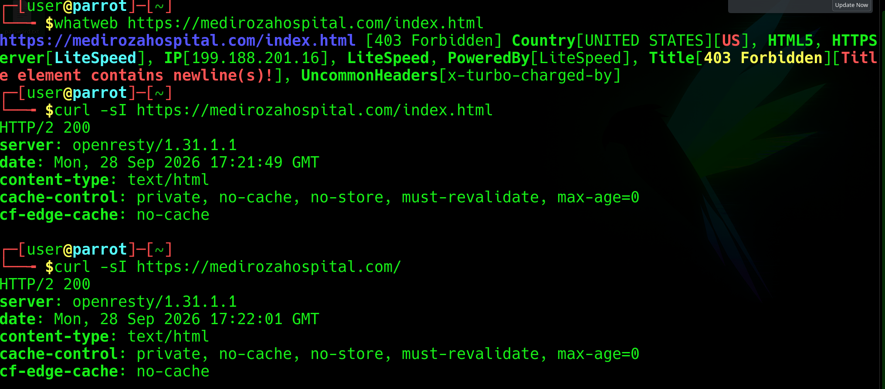

 **Screenshot 02 — Authentication Analysis**

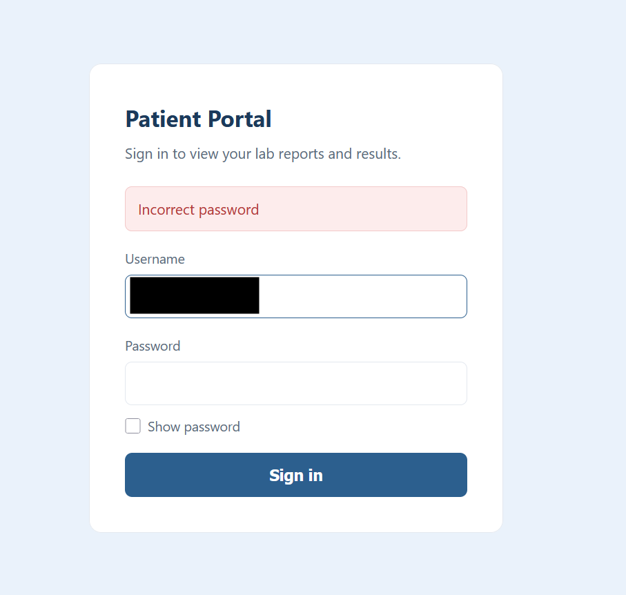

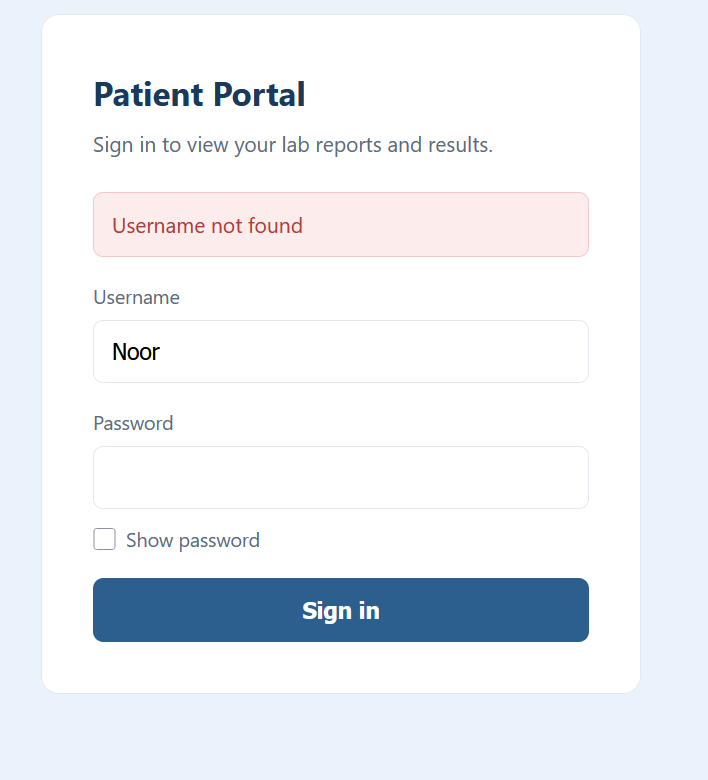

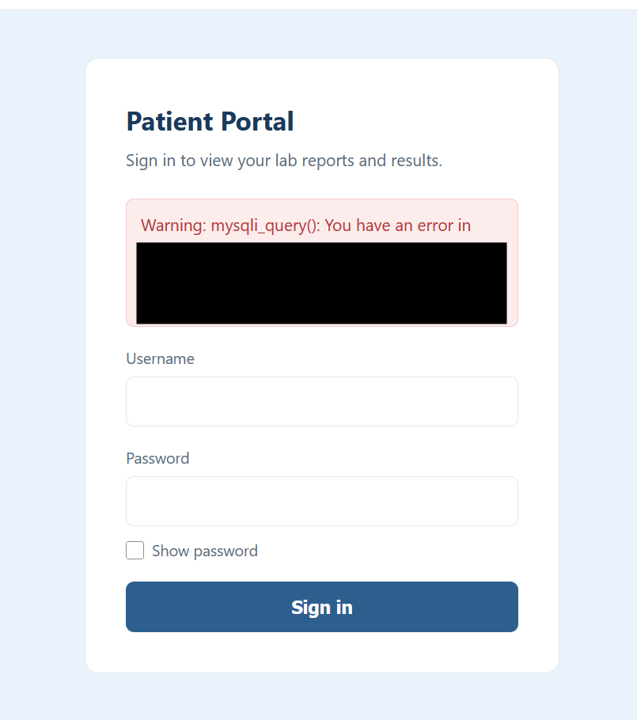


📸 **Screenshot 03 — Directory / File Discovery**

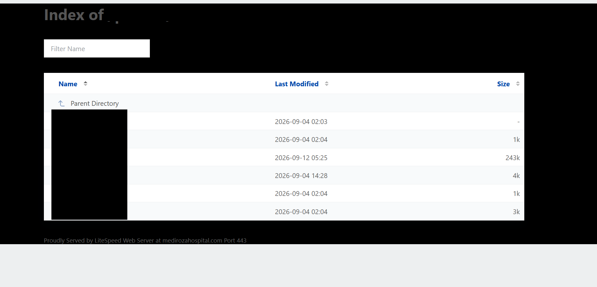

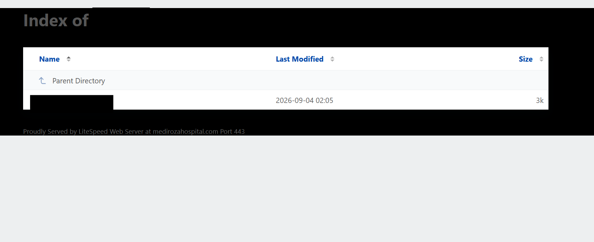


📸 **Screenshot 04 — Proof of Access**

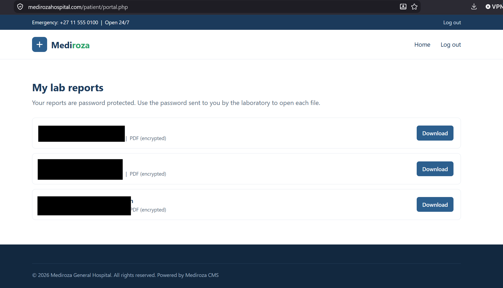

---

#  M2 — Data Extraction & Document Security

## Objective

Assess the protection mechanisms applied to the three recovered PDF laboratory reports.

The assessment examined whether the document encryption/password controls provided sufficient resistance against offline password-guessing attacks.

### Security Observation

The document protection mechanism relied on weak and predictable password patterns.

This created a significant security concern because once encrypted files are obtained, an attacker can conduct password-recovery attempts **offline**, without continuously interacting with the web application.

### Evidence

📸 **Screenshot 05 — PDF Encryption Analysis**

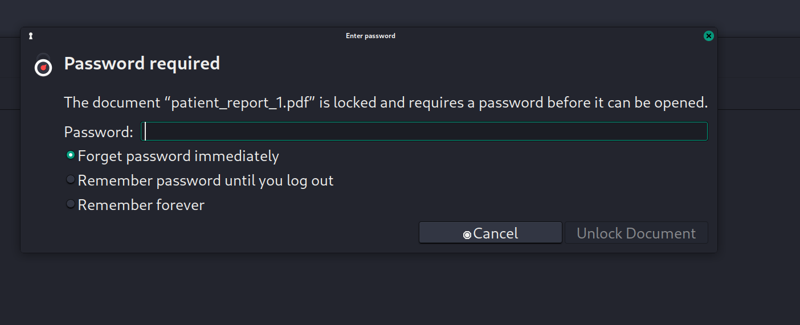

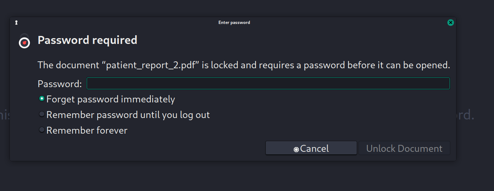

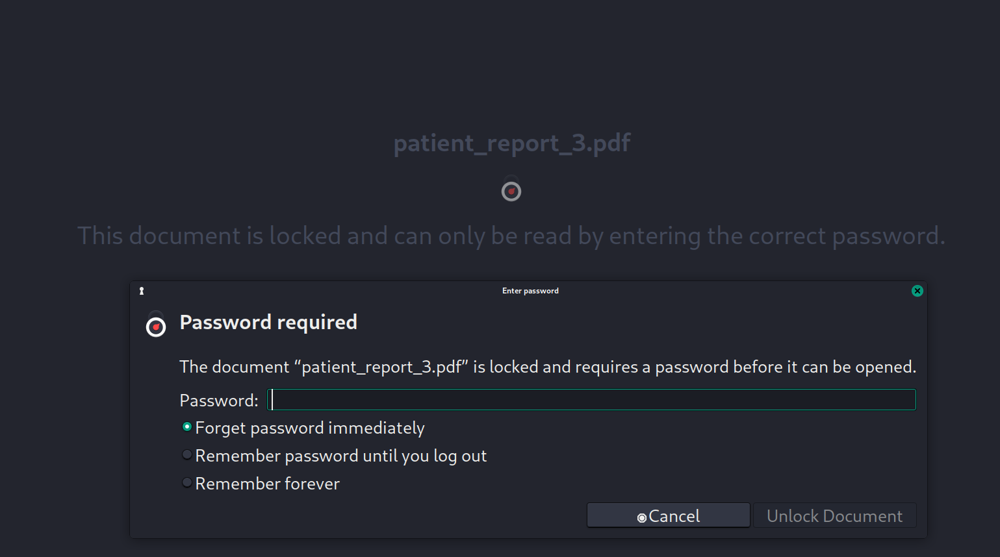


📸 **Screenshot 06 — Password Recovery Process**

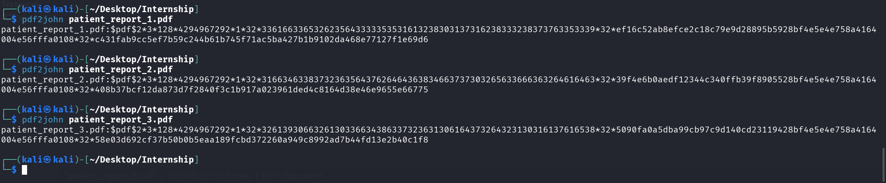

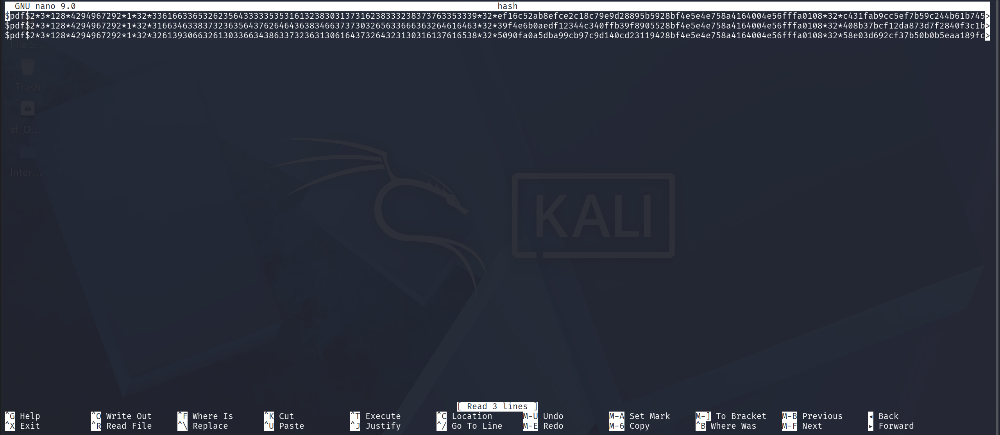

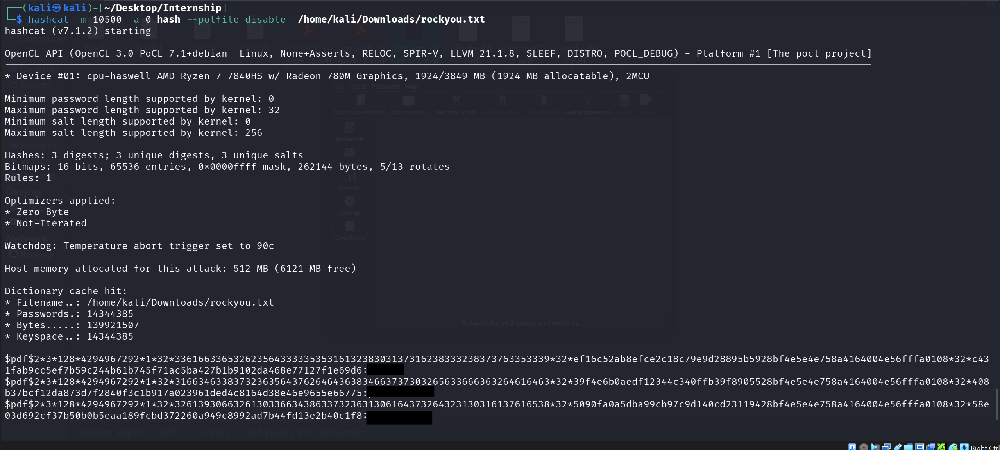

📸 **Screenshot 07 — Successfully Recovered Documents**

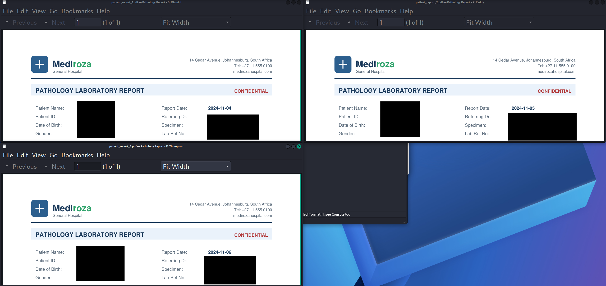

# M3 — Critical Data Exposure Analysis

## Objective

Analyze the information obtained during the assessment and identify additional sensitive information exposed by the target environment.

The milestone required investigation beyond the initially discovered documents and examination of available information for further security exposure.

### Sensitive Information Categories Identified

The assessment demonstrated exposure involving categories such as:

* Patient information
* Clinical/laboratory information
* Employee salary information
* Hospital shareholder information
* Internal application information
* Sensitive document metadata

This demonstrates the importance of **defense-in-depth**: compromising one security control should not automatically provide access to an organization's broader sensitive information.

### Evidence

📸 **Screenshot 08 — Metadata / Further Analysis**

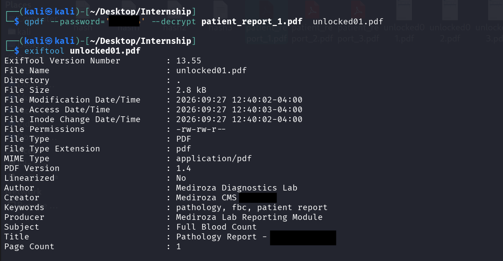

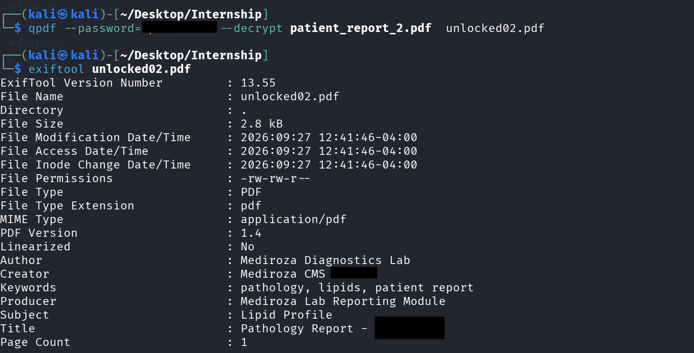

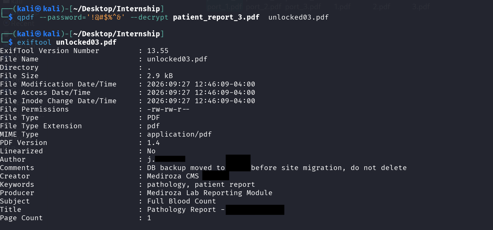

📸 **Screenshot 09 — Additional Data Exposure**

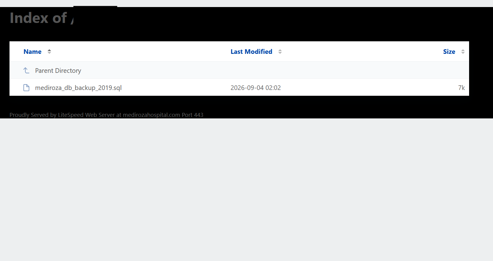

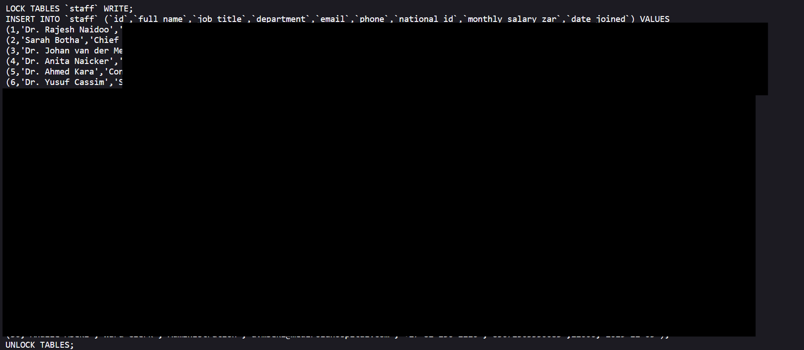

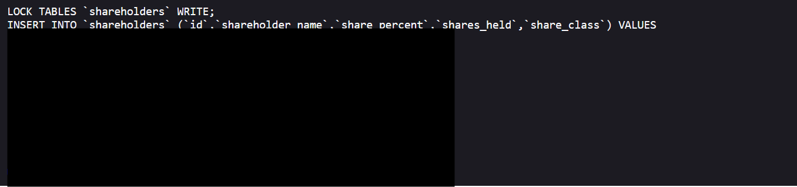

# Vulnerability Risk Classification

The findings were classified according to their potential impact and exploitability.

## CRITICAL

### SQL Injection — Authentication Bypass

**Risk:** CRITICAL
**CVSS v3.1:** 9.8

The application was found to process user-controlled input in an unsafe manner, allowing manipulation of database query logic and resulting in authentication bypass.

### Potential Impact

* Unauthorized authentication
* Privileged application access
* Sensitive data exposure
* Potential further application compromise
* Possible escalation into broader infrastructure attacks

### Recommendation

Implement:

* Prepared statements
* Parameterized queries
* Strict server-side input validation
* Least-privilege database accounts
* Secure error handling
* Security regression testing

---

# HIGH

## Directory Listing / Information Disclosure

**Risk:** HIGH
**CVSS v3.1:** 7.5

Directory indexing exposed application structures and sensitive document locations.

### Potential Impact

* Information disclosure
* Sensitive file discovery
* Attack-surface mapping
* Facilitation of subsequent attacks

### Recommendation

* Disable directory listing
* Restrict sensitive directories
* Move confidential files outside the public web root
* Implement authorization checks for every file request

---

## Weak PDF Cryptographic Protection

**Risk:** HIGH
**CVSS v3.1:** 7.4

The assessment demonstrated that weak and predictable document passwords significantly reduced the effectiveness of the encryption mechanism.

### Potential Impact

* Offline password attacks
* Unauthorized document decryption
* Exposure of confidential information

### Recommendation

Use:

* High-entropy randomly generated keys
* Strong password policies
* Enterprise key-management controls
* Key rotation
* Access logging
* Secure document-generation processes

---

# MEDIUM

## Username Enumeration

**Risk:** MEDIUM
**CVSS v3.1:** 5.3

The application generated distinguishable responses depending on whether an account existed.

### Potential Impact

Attackers could use this behavior to identify valid usernames and improve targeted credential attacks.

### Recommendation

Implement:

* Generic authentication error messages
* Rate limiting
* Progressive login delays
* MFA
* Authentication monitoring

---

## Sensitive Data Exposure

**Risk:** MEDIUM
**CVSS v3.1:** 5.3

Once document protection was bypassed, sensitive information could be viewed in readable form.

### Potential Impact

* Privacy violation
* Confidentiality loss
* Regulatory exposure
* Reputational damage

### Recommendation

Implement:

* Data minimization
* Sensitive-data masking
* Encryption at rest
* Encryption in transit
* Strong authorization controls
* Comprehensive access logging

---

# LOW

No additional standalone Low-severity vulnerability was prioritized in the final assessment matrix.

However, low-severity configuration weaknesses should still be monitored because several individually minor weaknesses can become significant when chained with higher-risk vulnerabilities.

---

# Attack Chain

One of the most important lessons from this assessment was that vulnerabilities should not always be considered individually.

The observed security chain can be represented as:

```text
Reconnaissance
      ↓
Authentication Analysis
      ↓
Username Enumeration
      ↓
SQL Injection
      ↓
Authentication Bypass
      ↓
Restricted Area Access
      ↓
Sensitive File Discovery
      ↓
Document Acquisition
      ↓
Offline Password Attack
      ↓
Document Decryption
      ↓
Sensitive Information Exposure
```

This demonstrates how multiple weaknesses can combine to create a substantially more serious security impact.

---

#  ICT Security Impact

The identified vulnerabilities potentially affect the three major dimensions of information security:

| Security Dimension  | Potential Impact                                                        |
| ------------------- | ----------------------------------------------------------------------- |
| **Confidentiality** |  High — sensitive information may be exposed                          |
| **Integrity**       |  High — privileged access may enable unauthorized changes             |
| **Availability**    |  Medium/High — successful escalation could enable disruptive activity |

### Business Risks

Potential organizational consequences include:

* Unauthorized access to sensitive information
* Privacy violations
* Loss of customer/patient trust
* Regulatory and legal exposure
* Credential compromise
* Further system compromise
* Potential ransomware or destructive activity following escalation

---

# Remediation Roadmap

## Priority 0 — Immediate

### 1. Eliminate SQL Injection

* Replace dynamic SQL queries
* Implement prepared statements
* Validate all user input
* Apply database least privilege
* Conduct security regression testing

### 2. Restrict Sensitive Files

* Disable directory indexing
* Remove sensitive files from public directories
* Implement server-side authorization
* Monitor unauthorized file requests

---

## Priority 1 — Urgent

### 3. Strengthen Document Protection

* Replace predictable passwords
* Implement strong cryptographic keys
* Establish centralized key management
* Implement key rotation

### 4. Harden Authentication

* Generic login error messages
* MFA for privileged accounts
* Rate limiting
* Brute-force protection
* Authentication monitoring

---

## Priority 2 — Planned

### 5. Strengthen Sensitive Data Protection

* Data minimization
* Encryption
* Data masking
* Role-based access control
* Security logging
* Periodic access reviews

---

#  Security Posture

### Overall Assessment

**CRITICAL**

The overall risk was classified as **CRITICAL** because multiple weaknesses could be chained together to progress from reconnaissance and authentication attacks to unauthorized access and sensitive-data exposure.

The most significant issue was the SQL Injection authentication bypass, while directory exposure and weak document protection increased the overall impact of the compromise.

---

#  Final Deliverable

As part of **Milestone 4**, I produced a detailed professional penetration-testing report containing:

* Executive Summary
* Scope and Methodology
* Vulnerability Findings
* Proof of Exploitation
* Risk Ratings
* CVSS scores
* Business Impact
* ICT Security Recommendations
* Remediation Roadmap
* Retest Criteria
* Confidentiality Notice

📄 **Professional Penetration Testing Report:**
[Professional_Cybersecurity_Penetration_Testing_Report](Professional_Cybersecurity_Penetration_Testing_Report.pdf)

---

# 🧠 Key Lessons Learned

This project provided practical experience in:

* Web application reconnaissance
* Authentication security assessment
* SQL Injection analysis
* Access-control testing
* Directory enumeration
* Sensitive-file discovery
* Password-security assessment
* Cryptographic protection analysis
* Data-exposure analysis
* Risk classification
* CVSS-based vulnerability assessment
* ICT security remediation
* Professional penetration-testing documentation

Most importantly, the project demonstrated that **security is not a single control**. Effective protection requires multiple layers working together across application security, authentication, access control, data protection, monitoring, and secure ICT architecture.

---

# 👨‍💻 Author

**Mustafa Hagibrahim**

Cybersecurity 

**Networkwalks — Batch B083**
**Week 4 Cybersecurity Internship Project**